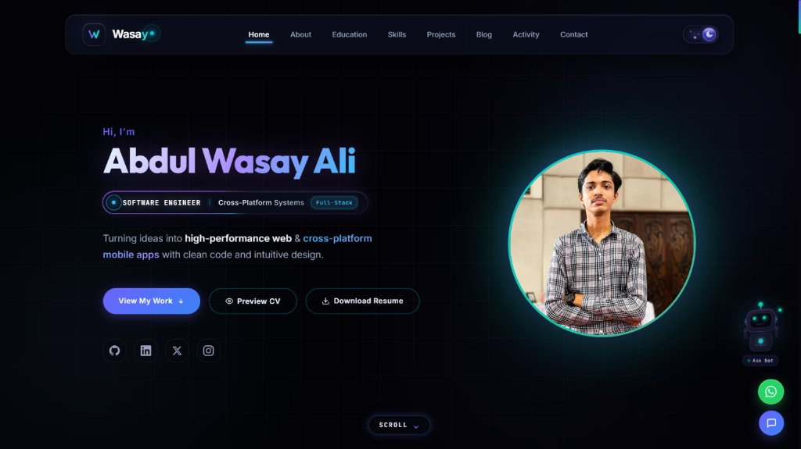

# Abdul Wasay Ali — Software Engineer & Mobile App Developer Portfolio

A high-performance developer portfolio and personal engineering platform built with **React 19**, **Vite 8**, **React Router v7**, **Framer Motion**, and **CSS Modules**. Designed with a modern dark aesthetic, luxury glassmorphic surfaces, fluid spring micro-interactions, an interactive AI companion widget, light/dark mode systems, dedicated **Engineering Case Study Pages (`/project/:id`)**, and **AI Workflow Case Studies (`/blog/:id`)**.

---

## Live Demo & Repository
- **Live Website:** [https://abdulwasayali.vercel.app/](https://abdulwasayali.vercel.app/)
- **GitHub Repository:** [https://github.com/AbdulWasayAli/Portfolio](https://github.com/AbdulWasayAli/Portfolio)
- **Developer:** Abdul Wasay Ali ([@AbdulWasayAli](https://github.com/AbdulWasayAli))
- **Deployment Platform:** Vercel

<div align="center">
  
</div>

---

## Key Features & Component Engineering

### 1. Jitter-Style Floating Squircle Navigation (`Navbar`)
- Floating capsule navigation bar (`border-radius: 20px`, `min-height: 76px`, `max-width: 1280px`).
- Active section indicator features a gradient glow bottom line (`.activeLine`) that transitions smoothly across navigation items.
- Clean vector brand logo with dual-tone gradient strokes (`#8b5cf6` to `#00e5ff`) and interactive hover micro-states.
- Interactive **Cosmic Day/Night Theme Switcher** with smooth dark/light transitions stored in `localStorage`.
- Responsive navigation drawer for mobile devices.

### 2. Interactive Morphing Floating Controls (`FloatingControls`)
- **WhatsApp Morphing Button:** Starts as a compact circular button (`48px`) showing only the official WhatsApp SVG icon. On hover, it expands into a full pill revealing "WhatsApp" text with fluid spring physics (`Framer Motion`).
- **Let's Connect Morphing Button:** Circular button displaying a chat bubble icon that expands into a pill with "Let's Connect" text on hover.
- **Scroll-to-Top Action:** Automatically appears when scrolling past 300px with a glowing accent ring and bounce animations.

### 3. Interactive 3D Cyber Companion & AI Chat (`FloatingRobot`)
- **Interactive 3D Robot Mascot:** Features 3D head tilting, real-time mouse coordinate eye-tracking, antenna, core reactor glow, and reactive blinking animations.
- **Branded Chat Window:** Ultra-luxurious obsidian glass modal styled with subtle borders and Wasay's geometric "W" brand logo in the header and message bubbles.
- **Clean Quick Chips:** Quick action buttons equipped with crisp Lucide SVG icons (`Zap`, `FolderGit2`, `Cpu`, `Briefcase`, `PhoneCall`).
- **Google Gemini AI Backend (`/api/chat`):** Serverless architecture with grounded developer persona, interactive mini project cards, and local fallback engine.

### 4. Direct Client Contact Channel (`Contact`)
- Direct message transmission using `@emailjs/browser` connected to developer email credentials.
- **Lottie-Style Animated Vector Stroke Dialog:** Zero-lag SVG dasharray draw animation featuring a rotating neon cyan outer circle that draws smoothly followed by an inner spring checkmark upon message dispatch.
- **Theme-Synchronized Obsidian Glass Modal:** Styled with deep obsidian (`#030307`), electric cyan (`#00e5ff`), and royal violet (`#6c63ff`) tokens.

### 5. Dedicated Project Case Studies (`/project/:id`)
- Deep engineering writeups replacing shallow popups using React Router v7.
- **Executive Summary:** Clear problem statements and technical objectives.
- **Product Capabilities:** Interactive feature checklist cards with vibrant cyan indicators.
- **System Architecture:** Detailed breakdown of database schemas, state management, and backend APIs.
- **Showcase Stage:** Full-fidelity media viewport with responsive aspect ratios for mobile and desktop screens.
- **Direct Navigation:** Previous/next project navigation and native web share API integration.

### 6. AI Engineering Blog Series (`/blog/:id`)
- Practical case studies documenting modern developer workflows and architectural adoption:
  1. **Google Antigravity IDE:** Autonomous multi-agent coding, terminal orchestration, and compilation verification.
  2. **Claude 3.7 / Sonnet:** Deep logic reasoning, Flutter BLoC/Provider architecture, and clean MVC refactoring.
  3. **Google Gemini:** High-speed context window, schema modeling, and multimodal visual UI-to-code pipelines.
  4. **Open Code & Cursor:** Keyboard-first velocity, repository-wide semantic indexing, and zero-latency flow state.
  5. **My Engineering Journey:** Lessons from academic fundamentals at Aptech to shipping scalable production apps.
- Equipped with custom **16:9 4K Cinema-Grade Cover Banners** for each tool and a fully responsive editorial modal viewer.

### 7. Giant Interactive Spotlight Brand Banner (`InteractiveBrandBanner`)
- Bold typography (**ABDUL WASAY ALI**) illuminated by an interactive cursor spotlight reveal.
- Themed with single-hue electric cyan (`#38bdf8`) in dark mode and deep sapphire blue (`#2563eb`) in light mode.

### 8. Luxury Atmospheric Background (`AtmosphericBackground`)
- Multi-emitter soft ambient glow spots paired with an ultra-subtle fine grid pattern for a calm, distraction-free backdrop.

### 9. Real-Time GitHub Activity Telemetry (`GitHubStats`)
- Live 1-year contribution graph integrated via `react-github-calendar` in Neon Emerald & Cyan.
- Real-time GitHub REST API metrics (stars, repositories, and continuous integration activity stream).

### 10. Performance & Asset Optimization (WebP Pipeline)
- Project media assets, blog covers, and profile visuals optimized in next-generation **WebP** format.
- Substantial reduction in total media payload, ensuring fast Largest Contentful Paint (LCP) and smooth rendering on mobile networks.

---

## Complete Tech Stack & Dependencies

### Dependencies (`package.json`)
| Package | Version | Purpose |
|---|---|---|
| **react** | `^19.2.7` | UI library for component architecture |
| **react-dom** | `^19.2.7` | React DOM rendering layer |
| **react-router-dom** | `^7.18.1` | Client-side routing (`/`, `/project/:id`, `/blog/:id`) |
| **framer-motion** | `^12.42.2` | Fluid spring physics, layout animations & transitions |
| **@emailjs/browser** | `^5.0.3` | Client-side email dispatch engine |
| **lucide-react** | `^1.61.0` | Crisp vector icons system |
| **react-github-calendar** | `^5.0.9` | Live interactive GitHub contribution activity calendar |
| **@splinetool/react-spline** | `^4.1.0` | React wrapper for interactive 3D Spline scenes |
| **@splinetool/runtime** | `^1.12.98` | 3D Spline web runtime engine |

### Dev Dependencies
| Package | Version | Purpose |
|---|---|---|
| **vite** | `^8.1.1` | Next-generation frontend tooling and bundler |
| **@vitejs/plugin-react** | `^6.0.3` | Official Babel-based React Fast Refresh plugin |
| **oxlint** | `^1.71.0` | High-speed Rust-based JavaScript & JSX code linter |
| **@types/react** | `^19.2.17` | TypeScript definitions for React |
| **@types/react-dom** | `^19.2.3` | TypeScript definitions for React DOM |

---

## Projects Featured in Portfolio

All projects are loaded directly from `src/data/portfolioData.js` and link to dedicated case study pages:

1. **Watch Store** *(Frontend / Design)*
   - **Stack:** HTML5, CSS3, Bootstrap
   - **Highlights:** Luxury timepiece showcase featuring product displays and responsive layouts.

2. **Historical Places Explorer** *(Frontend / Tourism)*
   - **Stack:** HTML5, CSS3, Bootstrap 5, Responsive Design
   - **Highlights:** Tourism discovery portal celebrating heritage monuments categorized by regional zones.
   - **Repo:** [github.com/AbdulWasayAli/Historical-Places](https://github.com/AbdulWasayAli/Historical-Places)

3. **ElectroShop — E-Commerce Platform** *(Frontend Web)*
   - **Stack:** JavaScript (ES6+), HTML5, CSS3, Bootstrap, AOS, LocalStorage
   - **Highlights:** Category filtering, dynamic client-side cart logic, form-validated checkout, and printable PDF invoices.
   - **Repo:** [github.com/AbdulWasayAli/Electronic-Store](https://github.com/AbdulWasayAli/Electronic-Store)

4. **SwiftShip — Courier Management System** *(Full-Stack Web)*
   - **Stack:** PHP, MySQL, JavaScript, Bootstrap, CRUD Workflows
   - **Highlights:** Logistics platform with parcel tracking, multi-branch agent workflows, and role-based authentication.
   - **Repo:** [github.com/AbdulWasayAli/Courier-Management-System](https://github.com/AbdulWasayAli/Courier-Management-System)

5. **E-Greetings — Digital Cards Platform** *(Full-Stack Web)*
   - **Stack:** ASP.NET Core MVC, C#, EF Core, SQL Server, SMTP
   - **Highlights:** Digital cards portal with scheduled SMTP email delivery, subscription tiers, and admin reports.
   - **Repo:** [github.com/AbdulWasayAli/Greetings-Project](https://github.com/AbdulWasayAli/Greetings-Project)

6. **EventEase** *(Mobile App)*
   - **Stack:** Flutter, Dart, Firebase, Role-Based Auth
   - **Highlights:** Full-lifecycle event management system with Attendee, Organizer, and Admin portals.
   - **Repo:** [github.com/AbdulWasayAli/EventEast](https://github.com/AbdulWasayAli/EventEast)

7. **CurrenSee** *(Mobile App)*
   - **Stack:** Flutter, Dart, REST API, State Management
   - **Highlights:** Real-time multi-currency converter, exchange rate trends, alerts, and gold-themed dark UI.
   - **Repo:** [github.com/AbdulWasayAli/Currency-Mobile-Application](https://github.com/AbdulWasayAli/Currency-Mobile-Application)

---

## Project Architecture & Directory Structure

```bash
portfolio-react/
├── public/
│   ├── images/
│   │   ├── og-preview.jpg         # High-definition 1200x630 social preview card (WhatsApp/LinkedIn)
│   │   ├── og-preview.webp        # Next-gen WebP social preview card
│   │   ├── portfolio-preview.jpg  # Latest showcase banner screenshot
│   │   ├── portfolio-preview.webp # Next-gen WebP showcase banner
│   │   ├── blog-*.webp            # Next-gen 16:9 AI tooling article banners
│   │   └── ...                    # Optimized WebP project screenshots & assets
│   ├── favicon.svg                # Custom cyber SVG favicon
│   ├── icons.svg                  # Vector SVG sprite sheet
│   ├── resume.pdf                 # Curriculum Vitae (PDF)
│   └── Abdul_Wasay_Ali_Resume.pdf # Latest verified CV
├── src/
│   ├── assets/                    # Static design vectors
│   ├── components/
│   │   ├── About/                 # Bio, achievements counter & profile visual
│   │   ├── AtmosphericBackground/ # Luxury ambient glow spots & fine grid backdrop
│   │   ├── Blog/                  # Horizontal carousel, cards & editorial article modal
│   │   ├── Contact/               # Contact cards, form with EmailJS & animated vector modal
│   │   ├── CyberCursor/           # GPU-accelerated fluid magnetic cyber cursor
│   │   ├── Experience/            # Educational background & timeline (Matric, Inter, Diploma)
│   │   ├── FloatingControls.jsx   # Quick WhatsApp & Connect morphing pill buttons + scroll-to-top
│   │   ├── FloatingRobot/         # Interactive 3D companion & AI chat assistant
│   │   ├── Footer/                # Social badges & quick navigation links
│   │   ├── GitHubStats/           # Real-time GitHub contribution calendar & terminal
│   │   ├── Hero/                  # Fluid typography headline, cyber status deck & CTAs
│   │   ├── InteractiveBrandBanner/# Giant spotlight typography banner
│   │   ├── Navbar/                # Jitter-style floating squircle navbar, drawer & cosmic theme toggle
│   │   ├── Projects/              # Project grid, filters & 3D tilt cards
│   │   ├── ScrollMatrix3D/        # 3D Quantum Horizon & Neural Aurora canvas
│   │   ├── Skills/                # Categorized skills matrix with tailored SVG badges
│   │   └── SplashScreen/          # Initial branded loading intro screen
│   ├── context/
│   │   └── ThemeContext.jsx       # Global dark/light theme state provider
│   ├── data/
│   │   ├── blogData.js            # Dedicated AI tools & career articles
│   │   └── portfolioData.js       # Single Source of Truth (Bio, Skills, Projects, Contacts)
│   ├── pages/
│   │   ├── BlogDetail.jsx         # Individual blog case study view
│   │   ├── ProjectDetail.jsx      # Dedicated project engineering case study page
│   │   └── NotFound.jsx           # 404 error page
│   ├── styles/
│   │   ├── globals.css            # CSS resets, utility animations & custom scrollbar
│   │   └── variables.css          # Color tokens, glassmorphic variables & theme radii
│   ├── App.jsx                    # Application routes, layout & progress bar
│   ├── main.jsx                   # React 19 entry point
│   └── index.css                  # Base stylesheet
├── api/
│   └── chat.js                    # Vercel Serverless Function (Google Gemini AI)
├── .oxlintrc.json                 # Oxlint configuration
├── package.json                   # Dependencies & scripts
├── vite.config.js                 # Vite build configurations
└── README.md                      # Comprehensive documentation
```

---

## Getting Started (Run Locally)

### 1. Prerequisites
- **Node.js**: `v18.0.0` or higher
- **npm**: `v9.0.0` or higher

### 2. Clone & Install
```bash
# Clone the repository
git clone https://github.com/AbdulWasayAli/Portfolio.git

# Navigate into project directory
cd Portfolio

# Install dependencies
npm install
```

### 3. Run Development Server
```bash
npm run dev
```
Open your browser and navigate to `http://localhost:5173`.

### 4. Build for Production
```bash
npm run build
```
Creates an optimized, minified production build inside the `dist/` directory.

### 5. Run Lint Check
```bash
npm run lint
```

---

## Contact & Connect

- **Developer:** Abdul Wasay Ali
- **Email:** [wasay3105@gmail.com](mailto:wasay3105@gmail.com)
- **Phone / WhatsApp:** [+92 3110214934](https://wa.me/923110214934)
- **Location:** C Area, Liaquatabad, Karachi, Pakistan
- **LinkedIn:** [Abdul Wasay Ali](https://www.linkedin.com/in/abdul-wasay-ali-295480256/)
- **GitHub:** [@AbdulWasayAli](https://github.com/AbdulWasayAli)
- **Twitter (X):** [@AbdulWasayAli09](https://x.com/AbdulWasayAli09)
- **Instagram:** [@abdulwasayali09](https://www.instagram.com/abdulwasayali09)

---

*If you find this project inspiring, please consider starring the repository on [GitHub](https://github.com/AbdulWasayAli/Portfolio).*
