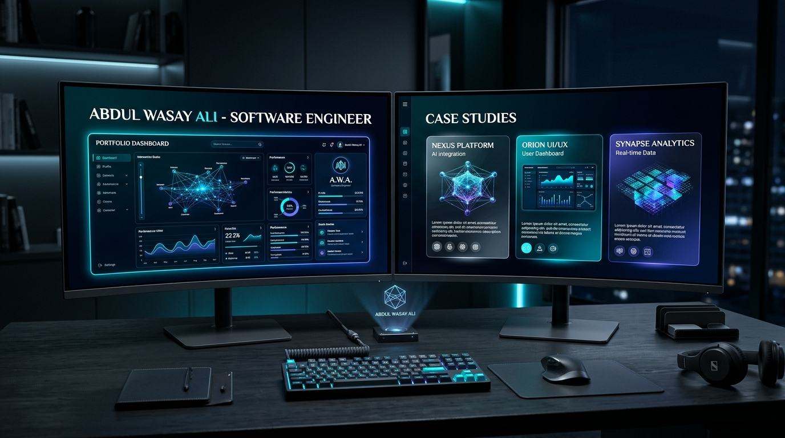

# Abdul Wasay Ali — Software Engineer & Mobile App Developer Portfolio

A next-generation, high-performance personal portfolio and engineering platform built with **React 19**, **Vite 8**, **React Router v7**, **Framer Motion**, and **CSS Modules**. Engineered with Silicon Valley obsidian aesthetics, an interactive 3D **Quantum Horizon & Chromatic Neural Aurora** background engine, fluid micro-interactions, an interactive AI companion widget, comprehensive Light/Dark mode design systems, dedicated **Engineering Case Study Pages (`/project/:id`)**, and hands-on **AI Workflow Case Studies (`/blog/:id`)**.

---

## 🌐 Live Demo & Repository
- **Live Website:** [https://abdulwasayali.vercel.app/](https://abdulwasayali.vercel.app/)
- **GitHub Repository:** [https://github.com/AbdulWasayAli/Portfolio](https://github.com/AbdulWasayAli/Portfolio)
- **Developer:** Abdul Wasay Ali ([@AbdulWasayAli](https://github.com/AbdulWasayAli))
- **Deployment Platform:** Vercel

<div align="center">
  
</div>

---

## 🚀 Key Features & Architectural Highlights

- **🌌 3D Quantum Horizon & Chromatic Neural Aurora Engine (`ScrollMatrix3D`):**
  - **Volumetric Chromatic Nebulas:** Multi-emitter organic liquid auroras flowing smoothly in deep space using Electric Cyan (`#00E5FF`), Royal Violet (`#8B5CF6`), and Indigo.
  - **3D Quantum Wave Terrain:** Infinitely moving 3D Tron horizon grid reacting to scroll velocity with matrix perspective transforms.
  - **High-Luminescence Synapse Constellation:** 3-layered luminescent star nodes with white hotspot cores, electric laser synapse beams, pulsating core pulsar rings, and fast racing data energy beacons.
  - **Interactive Cursor Gravity & Mobile Touch:** Magnetic attraction toward cursor on desktop and touch-coordinate deflection on mobile devices.
  - **Theme-Adaptive Rendering:** Automatically transitions to soft slate and crystal sky-blue hues when switching to Light Mode.

- **📑 Dedicated Case Study Architecture (`/project/:id`):**
  - Replaced clumsy, congested popups with high-end, dedicated full-screen case study pages using React Router v7.
  - **Executive Summary:** Clear problem statements and technical objectives.
  - **Product Capabilities:** Interactive feature checklist cards with vibrant cyan indicators.
  - **Under the Hood System Architecture:** Deep dive into database schemas, state management (BLoC/Provider), and backend APIs.
  - **High-Definition Showcase Stage:** Full-fidelity media viewport with responsive aspect ratios for mobile and desktop screens.
  - **Direct Shareability & Navigation:** Native web share API integration and previous/next project navigation controls.

- **📚 AI Engineering & Tool Mastery Blog Series (`/blog/:id`):**
  - Comprehensive, real-world engineering case studies documenting daily production workflows and architectural adoption:
    1. **Google Antigravity IDE:** Autonomous multi-agent coding, terminal orchestration, and compilation verification.
    2. **Claude 3.7 / Sonnet:** Deep logic reasoning, Flutter BLoC/Provider architecture, and clean MVC refactoring.
    3. **Google Gemini:** High-speed context window, schema modeling, and multimodal visual UI-to-code pipelines.
    4. **Open Code & Cursor:** Keyboard-first velocity, repository-wide semantic indexing, and zero-latency flow state.
    5. **My Engineering Journey:** Lessons from academic fundamentals at Aptech to shipping scalable production apps.
  - Equipped with custom **16:9 4K Cinema-Grade Cover Banners** for each tool and a fully responsive editorial modal viewer.

- **🌓 Comprehensive Ultra-Clean Light & Dark Mode Overhaul:**
  - 100% theme-aware CSS custom properties across all sections.
  - **Light Mode Elevation:** Frosted opal glass header, deep obsidian contrast navigation links, pearl crystal logo box, pure white porcelain cards with subtle borders (`rgba(15, 23, 42, 0.08)`), high-contrast typography (`#0f172a`), and polished titanium metallic signature banner.
  - **Cosmic Magnetic Theme Switcher:** 3D jewel specular thumb, day/night cosmic sky with animated starbursts and radiant solar corona.
  - **Default Preference:** Defaults to obsidian dark mode for maximum visual impact, while remembering user selections in `localStorage`.

- **📱 Next-Gen Mobile Ergonomics ("Mobile Vibe"):**
  - Responsive fluid typography powered by `clamp()` ensuring headings like `"ABDUL WASAY ALI"` fit on screens without awkward line breaking.
  - Adaptive canvas density preventing battery drain while delivering 120 FPS performance.
  - Optimized touch margins, floating action button stack (WhatsApp direct connect & scroll-to-top), and iOS-style glass navigation drawer.

- **🧲 Interactive Fluid Cyber-Cursor (`CyberCursor`):**
  - Dual-layer GPU lerp cursor with instant central neon dot and smooth trailing fluid ring.
  - Magnetic magnification on interactive cards and buttons with automatic graceful bypass on mobile touch devices.

- **🤖 Interactive 3D Cyber Companion & AI Chat Assistant (`FloatingRobot`):**
  - Real-time mouse coordinate tracking and pupil navigation with reactive hovering states.
  - **Obsidian/Frost Glassmorphic Chat Widget:** Powered by Framer Motion spring physics with verified badges, live beacons, and quick action prompt chips.
  - **Google Gemini AI Backend (`/api/chat`):** Serverless architecture with grounded developer persona and local fallback engine.

- **📈 Live GitHub Telemetry & Real-Time Contribution Calendar (`GitHubStats`):**
  - Live 1-year contribution graph integrated via `react-github-calendar` in Neon Emerald & Cyan.
  - Real-time GitHub REST API metrics (stars, repos, language ratios, and continuous integration activity stream).

- **✨ Giant Interactive Spotlight Brand Banner (`InteractiveBrandBanner`):**
  - Massive bold typography (**ABDUL WASAY ALI**) with polished titanium-indigo metallic chrome finish and interactive cursor spotlight reveal.

- **📄 Interactive Resume & CV Integration:**
  - In-browser full-screen modal CV preview with responsive iframe toolbar.
  - Direct 1-click download linked to the developer's verified latest CV (`resume.pdf`).

- **🛡️ Strict Code Quality & Performance:**
  - Zero dead code: completely purged obsolete modal components and redundant heavy video/image assets (~5.5 MB repo cleanup).
  - Oxlint linting, clean modular MVC folder hierarchy, and lightning-fast Vite build times.

---

## 🛠️ Complete Tech Stack & Tools

### Frontend & Core
| Technology | Version / Spec | Purpose |
|---|---|---|
| **React** | `^19.2.7` | UI library for component architecture |
| **React DOM** | `^19.2.7` | DOM rendering layer |
| **Vite** | `^8.1.5` | Next-gen frontend tooling and bundler |
| **React Router DOM** | `^7.18.1` | Client-side routing (`/`, `/project/:id`, `/blog/:id`) |
| **Framer Motion** | `^12.42.2` | Fluid spring physics, layout animations & transitions |
| **React GitHub Calendar** | `^5.0.9` | Live interactive GitHub contribution activity calendar |
| **Lucide React** | `^1.61.0` | Crisp vector icons system |
| **CSS Modules & Vanilla CSS** | W3C Standard | Scoped, zero-runtime overhead component styling |
| **Oxlint** | `^1.71.0` | High-speed JavaScript & JSX code linter |

### Backend, Cloud & AI
| Technology | Usage |
|---|---|
| **Google Gemini AI** | Conversational AI assistant engine for portfolio grounding |
| **Vercel Serverless Functions** | `/api/chat` serverless backend route |
| **Vite Dev Proxy Middleware** | Local development proxy for simulated serverless AI endpoints |

### Developer's Core Engineering Skills (Featured in Portfolio)
- **Frontend:** HTML5, CSS3, JavaScript (ES6+), React.js, Bootstrap 5.
- **Backend & APIs:** Python, Flask, Node.js, Express.js, PHP, Laravel, C# / ASP.NET Core, REST APIs.
- **Data & Databases:** R Programming, MySQL, Microsoft SQL Server, MongoDB, Firebase Firestore / Realtime DB.
- **Mobile Development:** Flutter, Dart, Firebase, Cross-Platform Android/iOS architectures.
- **AI Tooling & Agentic Workflows:** Google Antigravity, Claude 3.7 Sonnet, Google Gemini, Open Code, Cursor.
- **Tools & Workflow:** Git, GitHub, Figma, Postman, Vite, VS Code.

---

## 📂 Projects Featured in Portfolio

All projects are loaded directly from `src/data/portfolioData.js` and link to dedicated case study pages:

1. **EventEase** *(Mobile App)*
   - **Stack:** Flutter, Dart, Firebase, Role-Based Auth
   - **Highlights:** Full-lifecycle event management system with Attendee, Organizer, and Admin portals.
   - **Repo:** [github.com/AbdulWasayAli/EventEast](https://github.com/AbdulWasayAli/EventEast)

2. **CurrenSee** *(Mobile App)*
   - **Stack:** Flutter, Dart, REST API, State Management
   - **Highlights:** Real-time multi-currency converter, exchange rate trends, alerts, and gold-themed dark UI.
   - **Repo:** [github.com/AbdulWasayAli/Currency-Mobile-Application](https://github.com/AbdulWasayAli/Currency-Mobile-Application)

3. **SwiftShip — Courier Management System** *(Full-Stack Web)*
   - **Stack:** PHP, MySQL, JavaScript, Bootstrap, CRUD Workflows
   - **Highlights:** Logistics platform with shipment dispatch, tracking numbers, multi-branch agents, and role authentication.
   - **Repo:** [github.com/AbdulWasayAli/Courier-Management-System](https://github.com/AbdulWasayAli/Courier-Management-System)

4. **E-Greetings — Digital Cards Platform** *(Full-Stack Web)*
   - **Stack:** ASP.NET Core MVC, C#, EF Core, SQL Server, SMTP
   - **Highlights:** Greeting cards portal with automated scheduled SMTP email delivery, Pro subscription tiers, and admin reports.
   - **Repo:** [github.com/AbdulWasayAli/Greetings-Project](https://github.com/AbdulWasayAli/Greetings-Project)

5. **ElectroShop — E-Commerce Platform** *(Frontend Web)*
   - **Stack:** JavaScript (ES6), HTML5, CSS3, Bootstrap, AOS, LocalStorage
   - **Highlights:** Interactive category filtering, client-side cart logic, form-validated checkout, and printable PDF invoices.
   - **Repo:** [github.com/AbdulWasayAli/Electronic-Store](https://github.com/AbdulWasayAli/Electronic-Store)

6. **Historical Places Explorer** *(Frontend / Design)*
   - **Stack:** HTML5, CSS3, Bootstrap 5, Responsive Design
   - **Highlights:** Cultural tourism showcase categorized by geographic regions with rich visual storytelling.
   - **Repo:** [github.com/AbdulWasayAli/Historical-Places](https://github.com/AbdulWasayAli/Historical-Places)

7. **Watch Store** *(Frontend / Design)*
   - **Stack:** HTML5, CSS3, Bootstrap
   - **Highlights:** Elegant modern product showcase for luxury watches featuring smooth transitions and responsive layouts.

---

## 📁 Project Architecture & Directory Structure

```bash
portfolio-react/
├── public/
│   ├── images/
│   │   ├── blog-antigravity.jpg # Custom 16:9 Antigravity banner
│   │   ├── blog-claude.jpg      # Custom 16:9 Claude banner
│   │   ├── blog-gemini.jpg      # Custom 16:9 Gemini banner
│   │   ├── blog-opencode.jpg    # Custom 16:9 Open Code banner
│   │   ├── portfolio-preview.jpg # Cinema-grade executive showcase banner (16:9)
│   │   └── ...                  # Project screenshots & assets
│   ├── favicon.svg              # Custom cyber SVG favicon
│   ├── icons.svg                # Vector SVG sprite sheet
│   └── resume.pdf               # Curriculum Vitae (PDF)
├── src/
│   ├── assets/                  # Static design vectors
│   ├── components/
│   │   ├── About/               # Bio, achievements counter & profile visual
│   │   ├── Blog/                # Horizontal carousel, cards & editorial article modal
│   │   ├── Contact/             # Glassmorphic contact cards, copy badges & form
│   │   ├── CyberCursor/         # GPU-accelerated fluid magnetic cyber cursor
│   │   ├── Experience/          # Educational background & timeline
│   │   ├── FloatingControls.jsx # Quick WhatsApp chat & scroll-to-top buttons
│   │   ├── FloatingRobot/       # Interactive 3D companion & AI chat assistant
│   │   ├── Footer/              # Social badges & quick navigation links
│   │   ├── GitHubStats/         # Real-time GitHub contribution calendar & terminal
│   │   ├── Hero/                # Fluid typography headline, cyber status deck & CTAs
│   │   ├── InteractiveBrandBanner/ # Giant spotlight typography banner
│   │   ├── Navbar/              # Sticky navigation, mobile drawer & cosmic theme toggle
│   │   ├── Projects/            # Project grid, filters & 3D tilt cards
│   │   ├── ScrollMatrix3D/      # 3D Quantum Horizon & Neural Aurora canvas
│   │   ├── Skills/              # Categorized skills matrix with tailored SVG badges
│   │   └── SplashScreen/        # Initial branded loading intro screen
│   ├── context/
│   │   └── ThemeContext.jsx     # Global dark/light theme state provider
│   ├── data/
│   │   ├── blogData.js          # Dedicated AI tools & career articles
│   │   └── portfolioData.js     # Single Source of Truth (Bio, Skills, Projects, Contacts)
│   ├── pages/
│   │   ├── BlogDetail.jsx       # Individual blog case study view
│   │   ├── ProjectDetail.jsx    # Dedicated project engineering case study page
│   │   └── NotFound.jsx         # 404 error page
│   ├── styles/
│   │   ├── globals.css          # CSS resets, utility animations & custom scrollbar
│   │   └── variables.css        # Color tokens, glassmorphic variables & theme radii
│   ├── App.jsx                  # Application routes, layout & progress bar
│   ├── main.jsx                 # React 19 entry point
│   └── index.css                # Base stylesheet
├── api/
│   └── chat.js                  # Vercel Serverless Function (Google Gemini AI)
├── .oxlintrc.json               # Oxlint configuration
├── package.json                 # Dependencies & scripts
├── vite.config.js               # Vite build configurations
└── README.md                    # Comprehensive documentation
```

---

## 💻 Getting Started (Run Locally)

### 1. Prerequisites
- **Node.js**: `v18.0.0` or higher
- **npm**: `v9.0.0` or higher

### 2. Clone & Install
```bash
# Clone the repository
git clone https://github.com/AbdulWasayAli/Portfolio.git

# Navigate into project directory
cd Portfolio

# Install dependencies
npm install
```

### 3. Run Development Server
```bash
npm run dev
```
Open your browser and navigate to `http://localhost:5173`.

### 4. Build for Production
```bash
npm run build
```
Creates an optimized, minified production build inside the `dist/` directory.

### 5. Run Lint Check
```bash
npm run lint
```

---

## 📬 Contact & Connect

- **Developer:** Abdul Wasay Ali
- **Email:** [wasay3105@gmail.com](mailto:wasay3105@gmail.com)
- **Phone / WhatsApp:** [+92 3110214934](https://wa.me/923110214934)
- **Location:** C Area, Liaquatabad, Karachi, Pakistan
- **LinkedIn:** [Abdul Wasay Ali](https://www.linkedin.com/in/abdul-wasay-ali-295480256/)
- **GitHub:** [@AbdulWasayAli](https://github.com/AbdulWasayAli)
- **Twitter (X):** [@AbdulWasayAli09](https://x.com/AbdulWasayAli09)
- **Instagram:** [@abdulwasayali09](https://www.instagram.com/abdulwasayali09)

---

⭐ *If you find this project inspiring, please leave a star on [GitHub](https://github.com/AbdulWasayAli/Portfolio)!*
